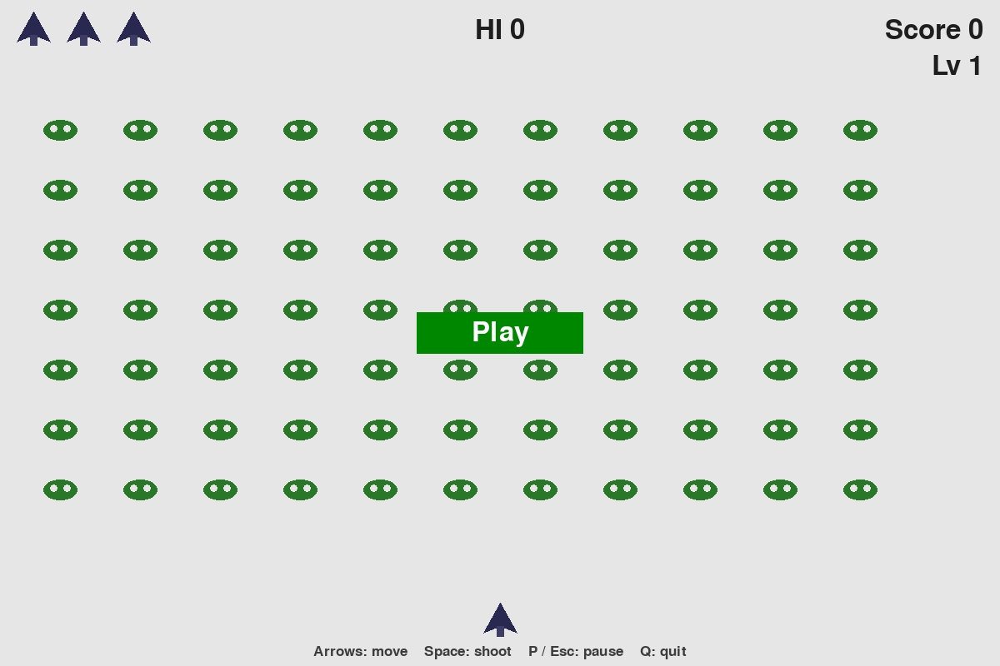
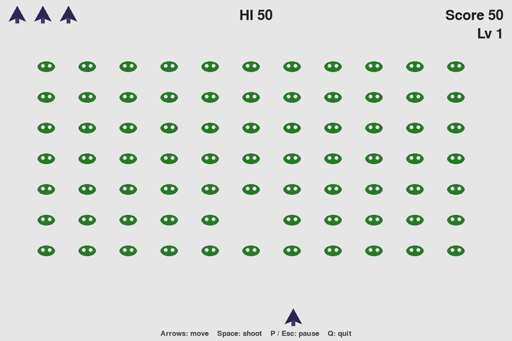

# Star Wars Mini · 星球大战 mini

A first-year Pygame exercise: a vertical shooter for practicing classes, objects, events, and the game loop.

这是我大一学人工智能时写的 Pygame 练习，一款纵向射击小游戏，用来把类、对象、事件和游戏循环放在一起看。

The structure follows the Alien Invasion project in Eric Matthes, *Python Crash Course* (No Starch Press; 中文版《Python 编程：从入门到实践》). The window title is `Star Wars Mini`. The sprites are an upward rocket and a green creature. Star Wars is a trademark of its owner; this is an unofficial student exercise, and the repository has no Star Wars artwork.

玩法结构参考 Eric Matthes 的《Python Crash Course》（No Starch Press，中文版《Python 编程：从入门到实践》）里的「外星人入侵」。窗口标题是 `Star Wars Mini`。画面上是一枚向上的火箭和一个绿色小生物。Star Wars / 星球大战是权利人的商标；这是非官方的学生练习，仓库里没有星球大战的角色或电影图片。

## Screenshots · 运行截图



The first frame after launch, captured under Xvfb on 2026-11-11 while running `python3 alien_invasion.py`. The fleet and the ship are already drawn, and they stay still until the round starts.

启动后的第一帧。2026-11-11 在 Xvfb 下运行 `python3 alien_invasion.py` 时截取。外星人和飞船已经画好，开始之前停在原地。



Later in that same Xvfb run: P starts the round, Right moves the ship, and Space fires. After the bullet hits one alien, the score is the integer 50 and `HI` becomes 50.

同一次 Xvfb 运行的后面：按 P 开始，按右方向键移动，按空格发射。子弹打中一个外星人后，分数是整数 50，`HI` 也变成 50。

The window size is hardcoded at 1200×800 in `settings.py`. With the current bitmaps, the opening fleet is 7 rows by 11 columns, 77 aliens.

窗口尺寸在 `settings.py` 里固定为 1200×800。按这个尺寸和现在的两张图，开局是 7 行 11 列，共 77 个外星人。

## What it does · 它会做什么

- Opens a 1200×800 window titled `Star Wars Mini` on a light gray background, `(230, 230, 230)`.
  打开 1200×800 的窗口，标题是 `Star Wars Mini`，背景是浅灰 `(230, 230, 230)`。
- A round starts with P, or with a left click on the green Play button.
  按 P，或用鼠标左键点击绿色 Play，开始一局。
- Left and Right move the ship inside the play area, between the score bar and the help line. Holding both keeps the ship still. Releasing a key stops that direction.
  左右方向键让飞船在分数栏和底部提示之间移动。两个方向一起按时，飞船停在原地。松开某个方向键，那个方向就停。
- Space fires one bullet upward on each key press. At most 3 bullets exist at once (`bullets_allowed`). Bullets are 3×15 rectangles and leave at the top edge of the window.
  每按一次空格向上发射一颗子弹。场上最多同时有 3 颗（`bullets_allowed`）。子弹是 3×15 的矩形，飞到窗口上沿后消失。
- Aliens move as one fleet. At the left or right edge of the window they drop 10 pixels and reverse. A new round starts them moving right.
  外星人整队移动。碰到窗口左缘或右缘时，下移 10 像素并折返。新的一局从向右开始。
- Each alien scores the current point value, and the total is stored exactly. The first value is 50. One bullet scores every alien it overlaps. The screen shows `Score`, `HI`, and `Lv` with the integer values.
  每个外星人加上当前分值，总分按整数原样保存。初始分值是 50。一颗子弹打中几个外星人，就加上几份分。屏幕上的 `Score`、`HI`、`Lv` 显示这些整数。
- Clearing the fleet starts the next level. Ship, bullet, and alien speeds are multiplied by 1.1. The point value becomes `int(points * 1.5)`. At 60 FPS the opening speeds are 1.5, 5.0, and 0.6 pixels per frame. After a stall, one frame counts as at most 3 frames of movement (`max_frame_scale`).
  清空一队后进入下一关。飞船、子弹、外星人的速度各乘 1.1。分值变成 `int(分值 * 1.5)`。60 FPS 下开局速度是每帧 1.5、5.0、0.6 像素。卡顿时，一帧最多按 3 帧的时间来补（`max_frame_scale`）。
- The ship has 3 lives, shown as small rockets at the top left. An alien that touches the ship, or reaches the bottom of the play area, removes one life. The third hit ends the round and shows `Game over` above the Play button. A hit that still leaves a life clears the bullets, builds a new fleet, recenters the ship, and waits 0.5 seconds while the screen says `Get ready`. Pause and quit still work during that wait.
  飞船有 3 条命，左上角用小火箭表示。外星人撞到飞船，或到达战斗区下沿，扣一条命。第三次受击后本局结束，Play 按钮上方显示 `Game over`。还剩命时，会清掉子弹、重新生成外星人、把飞船放回底部中央，并等待 0.5 秒，屏幕上写着 `Get ready`。等待时仍然可以暂停和退出。
- During a round, P or Esc pauses and resumes. The pause screen says `Paused - P / Esc to resume`. While paused, the ship, aliens, bullets, and the respawn timer stay still, and Space does not fire. The mouse is hidden during play and shown on the start screen, while paused, and after game over.
  一局进行中，P 或 Esc 暂停和继续。暂停画面写着 `Paused - P / Esc to resume`。暂停时飞船、外星人、子弹和受击等待都停住，空格也不发射。游戏进行时隐藏鼠标；在开始界面、暂停和结束后显示鼠标。
- Leaving the window pauses the round and clears the movement keys. Returning to the window leaves it paused until P or Esc.
  切换到别的窗口时，本局会暂停，并清掉移动状态。回到窗口后保持暂停，要按 P 或 Esc 才继续。
- Esc toggles pause only while a round is active. P before a round, or after game over, starts a new one. A new round resets speed, score, level, lives, pause, and the respawn timer. The saved high score remains.
  Esc 只在一局进行中切换暂停。开始前或结束后按 P，会开一局新的。新局会重置速度、分数、关卡、生命、暂停和受击等待，已保存的最高分还在。
- The high score is kept in `high_score.txt` beside `game_stats.py`. The game writes it when a round ends and when the program exits, using a temporary file and then replacing the old file. A missing, empty, negative, or unreadable file is treated as 0. If the save fails, the previous file stays and the program prints a warning.
  最高分存在 `game_stats.py` 旁边的 `high_score.txt`。一局结束和程序退出时保存：先写入临时文件，再替换旧文件。文件缺失、是空的、是负数或读不出来时，按 0 处理。保存失败时，旧文件留在原地，程序打出一条警告。
- Q, or closing the window, saves the high score, shows the mouse, and quits.
  按 Q，或关闭窗口，会保存最高分、显示鼠标并退出。
- `images/ship.bmp` and `images/alien.bmp` are loaded once from the `images` folder next to the source, then shared by the fleet and the life icons. The game finds them when started from another working directory.
  `images/ship.bmp` 和 `images/alien.bmp` 从源码旁边的 `images` 目录各加载一次，外星人和生命图标共用这些画面。从别的工作目录启动也能找到它们。
- The bottom line is the English help text from the source: `Arrows: move    Space: shoot    P / Esc: pause    Q: quit`.
  底部那一行就是源码里的英文提示：`Arrows: move    Space: shoot    P / Esc: pause    Q: quit`。

## Run · 运行

The tests are set up for Python 3.10 and 3.12. Pygame is pinned in `requirements.txt`. A display is required for the window. The automated tests use SDL's dummy video driver and do not need a visible screen.

测试按 Python 3.10 和 3.12 配置。Pygame 版本写在 `requirements.txt`。打开窗口需要图形界面。自动测试使用 SDL 的 dummy 视频驱动，不需要看得见的屏幕。

```bash
git clone https://github.com/jjh-python667/star-wars-mini.git
cd star-wars-mini
python -m pip install -r requirements.txt
python alien_invasion.py
```

If the command is `python3` on your machine, use `python3` in both places.

如果本机的命令是 `python3`，两处都写成 `python3`。

## Controls · 操作

| Key or mouse · 按键或鼠标 | What it does · 作用 |
| --- | --- |
| Left, Right · 左 / 右方向键 | Move. Both together hold the ship still. · 移动。一起按时停在原地。 |
| Space · 空格 | Fire, up to 3 bullets on screen. · 发射，场上最多 3 颗。 |
| P | Start a round, or pause and resume during one. · 开始一局；局中则暂停或继续。 |
| Esc | Pause and resume during a round. · 局中暂停或继续。 |
| Left click on Play · 左键点击 Play | Start a round from the button. · 从按钮开始一局。 |
| Q, or close the window · Q 或关闭窗口 | Save the high score and quit. · 保存最高分并退出。 |

## Project structure · 文件

| Path · 路径 | Role · 职责 |
| --- | --- |
| `alien_invasion.py` | Window, events, updates, drawing, and the game loop. · 窗口、事件、更新、绘制和游戏循环。 |
| `settings.py` | Window size, speeds, bullet limit, and level scaling. · 窗口、速度、子弹数量和过关难度。 |
| `ship.py` | The ship. Uses `images/ship.bmp` and moves inside the play area. · 飞船，使用 `images/ship.bmp`，在战斗区内移动。 |
| `alien.py` | One alien. Uses `images/alien.bmp` and checks the side edges. · 外星人，使用 `images/alien.bmp`，判断左右边缘。 |
| `bullet.py` | A bullet drawn as a rectangle. · 用矩形画出的子弹。 |
| `game_stats.py` | Score, level, lives, and the high-score file. · 分数、关卡、生命和最高分文件。 |
| `scoreboard.py` | Draws the score, high score, level, and life icons. · 画出分数、最高分、关卡和生命。 |
| `button.py` | The Play button in the center. · 屏幕中央的 Play 按钮。 |
| `images/ship.bmp`, `images/alien.bmp` | 60×48 rocket and 48×36 creature. See Images below. · 60×48 的火箭和 48×36 的小生物。说明见下方「图片」。 |
| `tests/test_game.py` | Regression tests with real Pygame sprites and an off-screen display. · 用真实 Pygame 精灵和无窗口显示做的回归测试。 |
| `.github/workflows/test.yml` | Runs those tests on Ubuntu and Windows, with Python 3.10 and 3.12. · 在 Ubuntu、Windows 上用 Python 3.10 和 3.12 跑同一组测试。 |
| `requirements.txt` | `pygame==2.6.1`. |
| `GAMEPLAY.md` | Notes from the 2026-11-10 code pass. Current behavior is the source and this README. · 2026-11-10 代码维护的记录。当前行为以源码和本 README 为准。 |
| `docs/screenshot-start.png`, `docs/screenshot.png` | Frames captured under Xvfb, shown above. · 上面两次画面，在 Xvfb 下截取。 |
| `LICENSE` | Standard MIT License text. · 标准 MIT 许可文本。 |
| `CHANGELOG.md` | Dated change log. · 按日期写的变更记录。 |
| `.gitignore` | Ignores caches and the local `high_score.txt`. · 忽略缓存和本地的 `high_score.txt`。 |

## Tests · 测试

```bash
python -m pip install -r requirements.txt
python -m unittest discover -s tests -v
```

The tests cover bullet and life limits, pause and focus loss, restarting, input, collisions and scoring, edges, launching from another directory, image reuse, and high-score saving. Score files for the tests go in a temporary directory. A full round is played by opening the game window.

测试覆盖子弹和生命上限、暂停和失焦、重新开始、按键、碰撞计分、边界、从其他目录启动、图片复用，以及最高分保存。测试用的分数文件写在临时目录里。完整的一局还是要打开窗口来玩。

## Images · 图片

`images/ship.bmp` is a 60×48 upward rocket. `images/alien.bmp` is a 48×36 green creature. Both are 24-bit BMPs whose corner color is the same light gray as the window. This repository does not record who made them. The bitmaps differ from the textbook originals in [ehmatthes/pcc_2e](https://github.com/ehmatthes/pcc_2e) and [ehmatthes/pcc_3e](https://github.com/ehmatthes/pcc_3e) (sha256 listed below). The textbook ship is a side-view rocket, and the textbook alien is a larger flying saucer (60×58).

`images/ship.bmp` 是 60×48 的向上火箭，`images/alien.bmp` 是 48×36 的绿色小生物。两张都是 24 位 BMP，四角的浅灰和窗口背景相同。仓库里没有写下作者。这两张图和 [ehmatthes/pcc_2e](https://github.com/ehmatthes/pcc_2e)、[ehmatthes/pcc_3e](https://github.com/ehmatthes/pcc_3e) 里的教材原图不同（sha256 见下表）。教材飞船是侧面火箭，教材外星人是更大的飞碟（60×58）。

| File · 文件 | sha256 |
| --- | --- |
| `images/ship.bmp` | `b1abcaf2cec453ad3ae4add9fc8eb4b05e5ae45b9eb5457963ded3843a36ad97` |
| `images/alien.bmp` | `85c1275d827b2258abce27ad83c3e2efadbd7426d6f42d25bca55e974adbe443` |
| Textbook `ship.bmp` · 教材 `ship.bmp` | `924dda87e662a296d70f2e10bf9b96a9bb470bd056ff5b6b4e169556eb7416ab` |
| Textbook `alien.bmp` · 教材 `alien.bmp` | `dec44dc6101217571e2dee19f502898d8225dcf4622f51e0a71d6cb67275072a` |

The textbook ship hash is the file `chapter_12/adding_ship_image/images/ship.bmp` in both repositories. The textbook alien hash is `chapter_13/creating_first_alien/images/alien.bmp` in both repositories.

教材飞船的哈希对应两个仓库里的 `chapter_12/adding_ship_image/images/ship.bmp`。教材外星人的哈希对应两个仓库里的 `chapter_13/creating_first_alien/images/alien.bmp`。

The text of *Python Crash Course* is not in this repository. The window title uses the Star Wars name, and the repository has no Star Wars artwork.

《Python Crash Course》的正文不在这个仓库里。窗口标题用了 Star Wars 这个名字，仓库里没有星球大战的角色或电影图片。

项目参考了教材示例，图片素材的授权需要单独核对，本仓库不对教材和素材作额外授权声明。

## License · 许可

Source code and project documentation are under the MIT License. See `LICENSE`. Copyright 2026 jjh-python667.

源代码和项目文档使用 MIT 许可，见 `LICENSE`。版权所有 © 2026 jjh-python667。

## Related · 相关

当前行为以这里的源码和本 README 为准。

- [作品集中的本项目页面](https://jjh-python667.github.io/projects/star-wars-mini.html)
- [作品集首页](https://jjh-python667.github.io/)
- [Python 学习记录](https://github.com/jjh-python667/python-learning)
- [个人学习 Agent](https://github.com/jjh-python667/personal-learning-agent)
